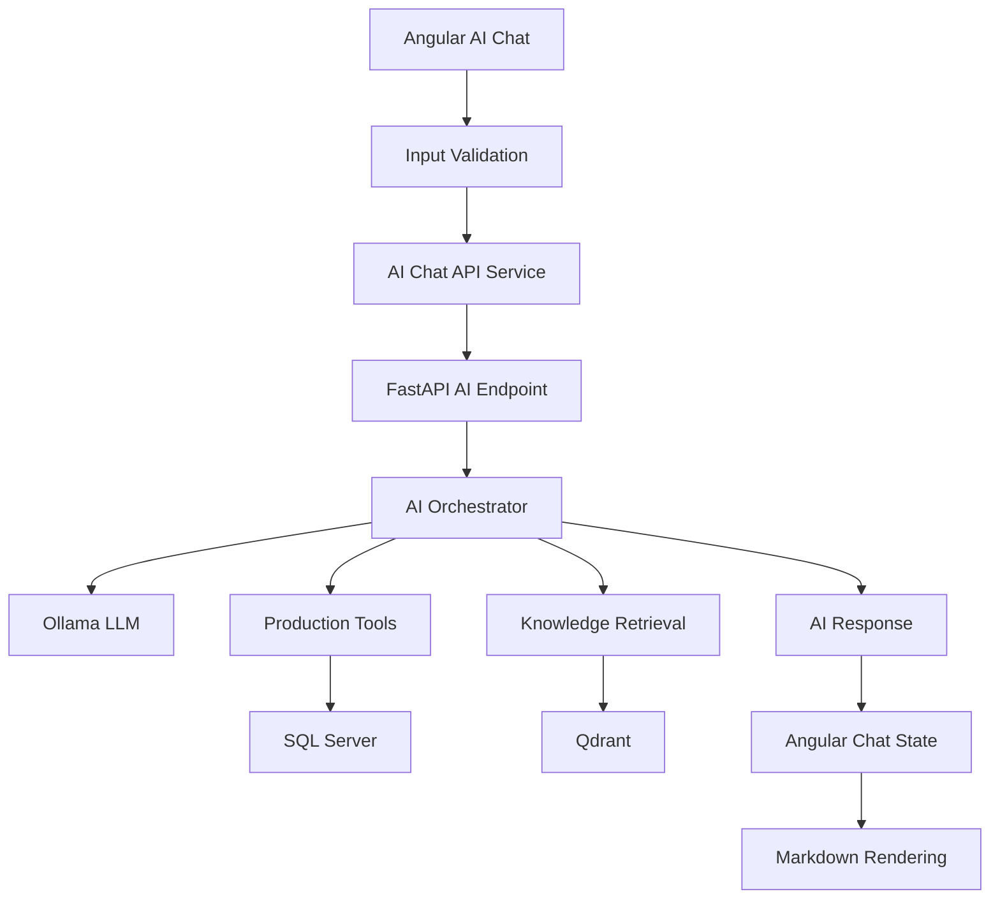

# AI Production Copilot — Frontend

Angular web application for AI Production Copilot, designed to provide production planners with a unified interface for production data, AI-assisted analysis, and company knowledge.

The application integrates with a FastAPI backend that provides AI orchestration, LLM inference, SQL Server integration, and Retrieval-Augmented Generation (RAG).

## Technology Stack

- Angular 22
- TypeScript
- Node.js 24 LTS
- npm
- SCSS
- Standalone Components
- Angular Router
- Angular Signals
- Reactive Forms
- RxJS
- HttpClient
- Marked
- Vitest

## Architecture

The frontend follows a feature-based architecture with separation of concerns between business features, application layout, API configuration, services, and shared utilities.

```text
src/
├── app/
│   ├── core/
│   │   ├── config/
│   │   │   └── api.config.ts
│   │   ├── pipes/
│   │   │   └── markdown-pipe.ts
│   │   ├── services/
│   │   │   ├── health.ts
│   │   │   └── health.spec.ts
│   │   └── utils/
│   │       └── api-error.ts
│   ├── features/
│   │   ├── dashboard/
│   │   ├── ai-chat/
│   │   │   ├── models/
│   │   │   │   └── chat.models.ts
│   │   │   ├── services/
│   │   │   │   ├── ai-chat-api.ts
│   │   │   │   └── ai-chat-api.spec.ts
│   │   │   ├── ai-chat.ts
│   │   │   ├── ai-chat.html
│   │   │   ├── ai-chat.scss
│   │   │   └── ai-chat.spec.ts
│   │   ├── inventory/
│   │   ├── orders/
│   │   ├── knowledge/
│   │   └── evaluation/
│   ├── layout/
│   │   └── main-layout/
│   ├── app.config.ts
│   ├── app.routes.ts
│   ├── app.ts
│   ├── app.html
│   └── app.scss
└── styles.scss
```

## Implemented Features

### Application Foundation

- Responsive application layout
- Sidebar navigation
- Standalone Angular components
- Feature-based architecture
- Lazy-loaded feature routes
- Centralized API configuration
- FastAPI integration
- Reactive API availability status
- Manual API connection refresh
- Automated frontend tests
- Optimized production build

### AI Production Assistant

The AI Chat interface enables production planners to interact with the backend AI orchestration system using natural language.

Supported capabilities:

- Production data analysis
- Material shortage analysis
- Company knowledge retrieval
- Production procedure assistance
- Combined production data and knowledge retrieval
- General AI-assisted questions

Implemented frontend features:

- Typed API request and response models
- In-memory chat message history
- Angular Signals for reactive state management
- Reactive Forms
- Input validation
- Maximum message length of 2,000 characters
- Duplicate request prevention
- AI processing indicators
- HTTP request timeout
- Centralized API error mapping
- Manual retry mechanism
- Retry without duplicate user messages
- Automatic scrolling mechanism
- Markdown rendering
- Responsive dark-themed chat interface
- CSS animations and microinteractions
- Reduced-motion accessibility support
- Component and HTTP service tests

## Application Routes

| Route | Feature | Status |
|---|---|---|
| `/dashboard` | Production Dashboard | Planned |
| `/ai-chat` | AI Production Assistant | Implemented |
| `/inventory` | Inventory Management | Planned |
| `/orders` | Production Orders | Planned |
| `/knowledge` | Company Knowledge Base | Planned |
| `/evaluation` | AI Evaluation | Planned |

All feature routes are implemented with lazy loading.

The AI Chat feature is integrated with the backend. Remaining business feature pages currently contain placeholder components.

## Prerequisites

- Node.js 24 LTS
- npm
- Docker Desktop
- Running AI Production Copilot backend
- Configured SQL Server database
- Configured Qdrant knowledge collection
- Running Ollama instance with required models

See the main project README for backend initialization and AI model configuration.

## Getting Started

### 1. Start the Backend

From the repository root:

```bash
docker compose up -d
```

The backend must be configured according to the main project README.

### 2. Install Frontend Dependencies

```bash
cd frontend
npm ci
```

### 3. Start the Development Server

```bash
npm start
```

Open http://localhost:4200 in your browser.

The development server automatically reloads the application when source files change.

### 4. Open the AI Assistant

Navigate to:

```text
http://localhost:4200/ai-chat
```

Example questions:

- Jakich materiałów aktualnie brakuje?
- Jak należy postępować w przypadku awarii maszyny CNC?
- Jakich materiałów brakuje i jak należy postępować zgodnie z procedurą magazynową?

The AI assistant retrieves production data and company knowledge through backend-managed tools.

## Local Services

| Service | URL |
|---|---|
| Angular Frontend | http://localhost:4200 |
| FastAPI Backend | http://localhost:8000 |
| Swagger UI | http://localhost:8000/docs |
| OpenAPI Specification | http://localhost:8000/openapi.json |

## API Configuration

The backend base URL and AI request timeout are centralized in:

```text
src/app/core/config/api.config.ts
```

Current development configuration:

```typescript
export const API_BASE_URL = 'http://localhost:8000';

export const AI_REQUEST_TIMEOUT_MS = 300_000;
```

AI requests have a five-minute client-side timeout to accommodate local LLM inference and multi-step AI orchestration.

This timeout is an initial development configuration and is not a production service-level objective.

Environment-specific API configuration will be introduced during containerization and cloud deployment.

## Backend Integration

The frontend communicates with the FastAPI backend using Angular HttpClient.

### Integrated API Endpoints

| Method | Endpoint | Purpose |
|---|---|---|
| GET | `/health` | Backend availability check |
| POST | `/ai/chat` | AI orchestration and natural language interaction |

### Health Service

API availability is represented by three reactive states:

| State | Description |
|---|---|
| Checking | Health request is in progress |
| Online | Health endpoint responded successfully |
| Offline | Request failed or exceeded the timeout |

The application checks API availability during layout initialization.

Users can manually refresh the connection status by clicking the API status indicator.

Health requests have a five-second timeout.

The health indicator represents API endpoint availability and does not guarantee the availability of SQL Server, Qdrant, Ollama, or other backend dependencies.

### AI Chat API

The frontend sends natural language questions to the unified AI orchestration endpoint.

Example request:

```http
POST /ai/chat
Content-Type: application/json
```

```json
{
  "message": "Jakich materiałów aktualnie brakuje?"
}
```

Example response:

```json
{
  "answer": "Aktualnie brakuje 650 nakrętek M8."
}
```

The backend determines whether the question requires production data, company knowledge, or both.

The frontend does not directly communicate with the LLM, SQL Server, or vector database.

## AI Request Flow



## State Management

The AI Chat component uses Angular Signals for local reactive state management.

| State | Responsibility |
|---|---|
| `messages` | In-memory chat message history |
| `isLoading` | Active AI request state |
| `error` | User-facing error message |
| `failedMessage` | Last failed question available for retry |
| `messageControl` | Reactive input form control |

RxJS is used for asynchronous HTTP communication, timeout handling, subscription lifecycle management, and request finalization.

## Error Handling

API errors are mapped to user-friendly messages through a shared error utility.

```text
src/app/core/utils/api-error.ts
```

Supported error scenarios include:

| Error | Handling |
|---|---|
| Network or connection failure | Connection error message |
| HTTP 400 / 422 | Invalid request message |
| HTTP 401 | Authentication required |
| HTTP 403 | Permission denied |
| HTTP 429 | Too many requests |
| HTTP 500 | Internal server error |
| HTTP 502 / 503 / 504 | Service unavailable |
| Request timeout | Timeout notification |
| Unexpected error | Generic error message |

Internal backend exceptions and raw stack traces are not displayed in the user interface.

## Retry Mechanism

Failed AI requests can be manually retried.

The retry mechanism:

- Stores the last failed question.
- Displays a retry button.
- Resends the original question.
- Prevents duplicate user messages in the chat history.
- Prevents concurrent submissions from the chat component.
- Clears the error state when a new attempt starts.

Automatic retries are intentionally avoided because repeated LLM requests may increase inference costs and resource consumption.

A client-side timeout or cancellation does not guarantee that backend processing has stopped.

## Markdown Rendering

AI-generated responses are converted from Markdown to HTML using the Marked library and a reusable Angular pipe.

Supported formatting includes:

- Headings
- Bold and italic text
- Ordered and unordered lists
- Tables
- Code blocks
- Inline code
- Links

Assistant messages use Markdown rendering, while user messages are displayed as plain text.

Generated HTML is rendered through Angular's standard HTML sanitization mechanism.

The application does not bypass Angular HTML sanitization.

Additional security controls for generated links, external images, and untrusted Markdown are planned before production deployment.

## User Interface

The AI Chat interface includes:

- Dark-themed design
- Gradient message bubbles
- AI and user avatars
- Animated processing indicator
- Responsive chat container
- Custom scrollbars
- Character counter
- Interactive message composer
- Error notifications
- Retry controls
- Reduced-motion support

The interface is implemented using SCSS without requiring an additional UI component framework.

## Testing

The frontend uses Vitest and Angular TestBed for automated testing.

### Development Tests

```bash
npm test
```

### CI/CD Tests

```bash
npm run test:ci
```

The CI command executes all tests once without enabling watch mode.

### Test Coverage Areas

- Root application component
- Router outlet rendering
- Application layout
- Health Service
- HTTP request validation
- API availability states
- API failure handling
- API recovery
- Feature component initialization
- AI Chat API service
- AI request payload validation
- AI response handling
- HTTP error propagation
- AI Chat component initialization
- Chat message state updates

HTTP service tests use HttpTestingController to simulate backend responses without requiring running backend services.

Component tests use mocked service dependencies and do not require LLM inference.

### Validation Status

| Validation | Result |
|---|---|
| Automated frontend tests | Passed |
| Non-watch test execution | Passed |
| Production build | Passed |
| Manual AI integration test | Passed |
| Backend failure and recovery scenario | Passed |
| Manual retry scenario | Passed |
| Markdown rendering | Passed |

Extended automated tests for request timeouts, retry behavior, and Markdown security remain planned.

## Production Build

Generate an optimized production build:

```bash
npm run build
```

Build output:

```text
dist/frontend/browser/
```

The production build includes:

- TypeScript compilation
- Template compilation
- JavaScript bundling
- Tree shaking
- Minification
- Lazy-loaded feature chunks
- Optimized static assets

### Initial Build Baseline

| Metric | Result |
|---|---:|
| Main JavaScript bundle | 258.05 kB |
| Estimated main bundle transfer size | 69.65 kB |
| Lazy-loaded feature chunks | 6 |
| Build duration | 2.582 seconds |

These measurements represent the initial Angular foundation before the AI Chat implementation.

Updated bundle measurements will be collected during frontend containerization and CI/CD integration.

## Available npm Commands

| Command | Description |
|---|---|
| `npm ci` | Install dependencies using the lock file |
| `npm start` | Start the development server |
| `npm run build` | Generate a production build |
| `npm run watch` | Build in development watch mode |
| `npm test` | Run development tests |
| `npm run test:ci` | Run automated tests without watch mode |

## Development Principles

- Feature-based architecture
- Separation of concerns
- Strict TypeScript configuration
- Reusable services and components
- Reactive state management
- Lazy loading
- Centralized API communication
- Explicit loading and error states
- Typed API contracts
- Controlled AI request execution
- Safe rendering of untrusted content
- Automated testing
- Reproducible dependency installation
- CI/CD readiness

## Security Considerations

- No backend credentials or API secrets should be stored in frontend source code.
- Backend CORS configuration restricts cross-origin browser access in the local development environment.
- CORS is not a replacement for authentication or authorization.
- Business logic and sensitive operations remain on the backend.
- AI-generated content is treated as untrusted data.
- Angular HTML sanitization remains enabled.
- User messages are rendered as plain text.
- Raw backend exceptions are not exposed in the interface.
- Authentication and authorization will be introduced during later development milestones.

## Current Limitations

- Dashboard, inventory, orders, knowledge, and evaluation pages remain placeholders.
- API configuration currently targets the local development environment.
- API health checks are performed on initialization and manual refresh.
- Chat history is stored only in component memory.
- Chat history is lost when the component is destroyed or the page is refreshed.
- Each AI question is processed independently.
- Conversation history is not sent to the backend.
- Token streaming is not implemented.
- Server-side request cancellation is not implemented.
- Only the most recent failed question can be retried.
- Automatic scrolling requires additional long-conversation validation.
- Extended frontend security and failure scenario tests are planned.
- Authentication and authorization are not yet implemented.
- Frontend containerization is not yet implemented.
- Cloud deployment and automated pipelines are planned for future milestones.

## Roadmap

### Phase 1 — Angular Foundation

- [x] Angular project initialization
- [x] Feature-based architecture
- [x] Application layout
- [x] Routing and lazy loading
- [x] HttpClient configuration
- [x] Angular Signals integration
- [x] Backend health integration
- [x] Automated frontend tests
- [x] Production build
- [x] CI test command

### Phase 2 — Business Features

- [x] AI Chat interface
- [x] AI orchestration endpoint integration
- [x] Typed AI request and response models
- [x] In-memory chat message history
- [x] Reactive Forms and input validation
- [x] Loading and error states
- [x] Centralized API error handling
- [x] AI request timeout
- [x] Manual retry mechanism
- [x] Duplicate request prevention
- [x] Automatic scrolling implementation
- [x] Markdown rendering
- [x] Responsive AI Chat design
- [x] AI Chat component and service tests
- [ ] Production dashboard
- [ ] Inventory management views
- [ ] Production order views
- [ ] Knowledge base interface
- [ ] AI evaluation interface

### Phase 3 — Production Readiness

- [ ] Frontend Dockerfile
- [ ] Nginx configuration
- [ ] Full-stack Docker Compose integration
- [ ] Environment-specific API configuration
- [ ] Azure DevOps CI/CD pipelines
- [ ] Microsoft Entra ID authentication
- [ ] Azure cloud deployment
- [ ] Application monitoring
- [ ] Production release and rollback strategy

### Phase 4 — Future AI Chat Enhancements

- [ ] Persistent conversation history
- [ ] Multi-turn conversation context
- [ ] Streaming AI responses
- [ ] Server-side request cancellation
- [ ] Structured source citations
- [ ] Extended Markdown security controls
- [ ] Extended frontend failure scenario tests

## Project

This frontend is part of the AI Production Copilot portfolio project, demonstrating practical AI engineering, full-stack development, cloud integration, and production-oriented software delivery.

For backend architecture, AI orchestration, RAG implementation, database configuration, and project-wide documentation, see the [main project README](../README.md).
